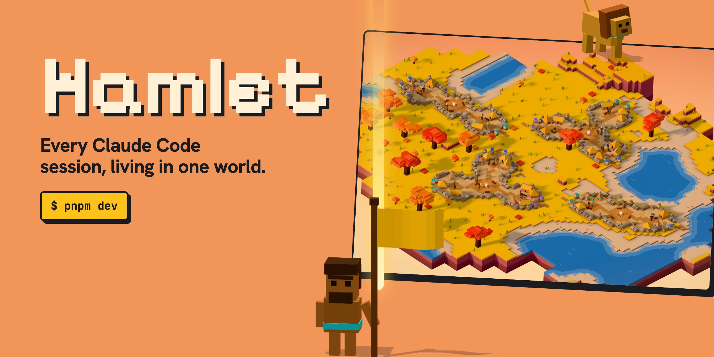
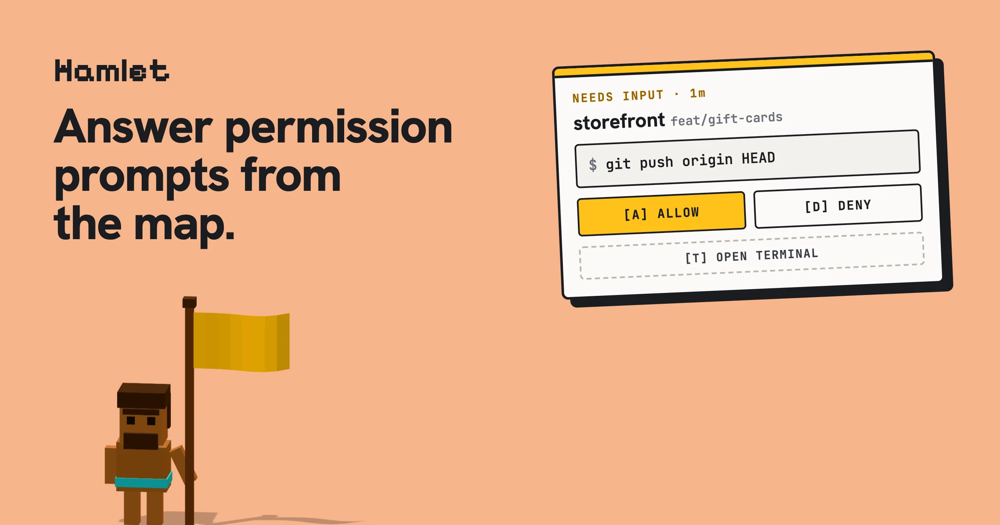
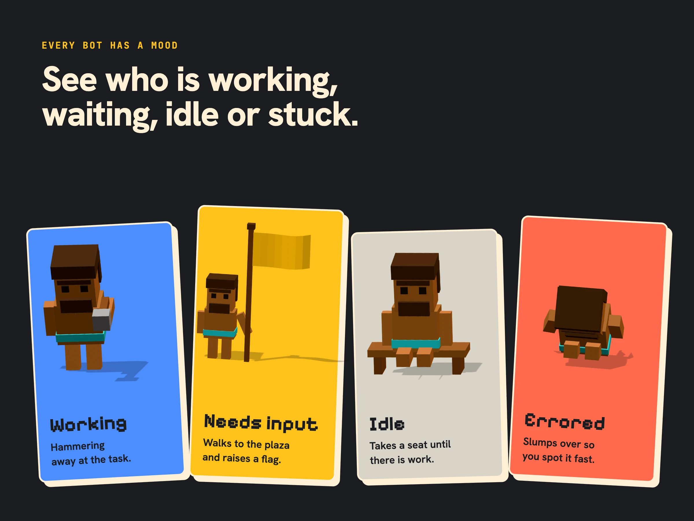
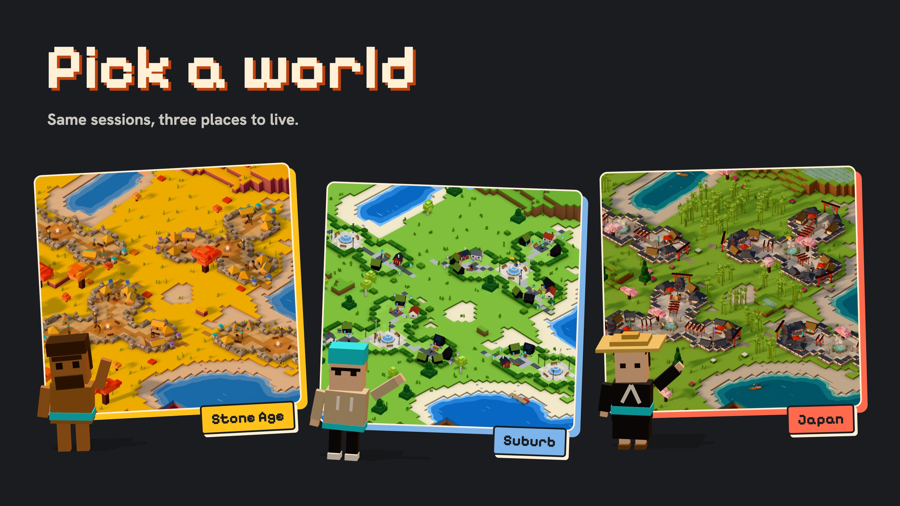

<p align="center">
  
</p>

# Hamlet

A tiny village where your Claude Code sessions live as bots. Hamlet listens to Claude Code's
hooks, shows each session as a bot in a 3D world, and lets you answer permission requests from
the village instead of hunting for the right terminal.

> **Status: early prototype.** Expect rough edges and breaking changes.

## Quickstart

You need Node.js 22+, pnpm 12, [Claude Code](https://claude.com/claude-code) and a browser with
WebGPU support.

```sh
git clone https://github.com/Isak-gerre/hamlet.git
cd hamlet
pnpm install
pnpm install-hooks   # shows the change to ~/.claude/settings.json and asks before writing it
pnpm dev             # starts the daemon and the web UI together
```

Open the URL from the `web` pane, start a Claude Code session, and a bot appears.

> **Heads up:** `install-hooks` changes your global Claude Code settings. It only adds Hamlet's
> own entries and backs the file up first. If the daemon isn't running, Claude Code treats the
> hook as a non-blocking error and falls back to its normal prompt. To remove the hooks, run
> `pnpm uninstall-hooks`.

## Features







- **Answer from the map.** Allow or deny a permission request without finding its terminal, or
  press `T` to jump to that terminal. Questions Claude asks with options (`AskUserQuestion`) show
  as buttons, with multi-select and "Other".
- **Read a session's conversation.** Press `C` on a bot to open its chat in a sheet beside the
  village: prompts, replies rendered as markdown, tool calls with their results and diffs, and
  subagent work, updated live from the transcript. Pick another bot and the sheet follows.
- **Reply from the chat.** Type into a session running in cmux without switching to its terminal.
  Multi-line messages arrive as one prompt, and `/` lists the session's skills and commands plus
  `/clear`, `/compact`, `/context` and `/cost`. Sending waits while a permission prompt is open.
- **Know when a bot needs you.** A sound, and optionally a desktop notification, when a bot starts
  waiting while the tab is in the background. The tab title counts the waiting bots.
- **See every session at a glance.** Bots show whether they are working, waiting, idle or errored,
  and a name tag says what each one is doing, such as "Editing bots.ts". Sessions that were already
  running when Hamlet started show up too.
- **Repos become towns.** Each repo is a town and each branch a district.
- **Three worlds and a day cycle.** Choose a world and a time of day in settings, or let the day
  run on its own.

## Usage

| Key | Action |
| --- | --- |
| `N` | Jump to the next waiting bot |
| `A` / `D` | Allow / deny the open permission request |
| `T` | Open the bot's terminal |
| `C` | Open the bot's chat (`ESC` closes it) |
| `F` | Frame the whole world |
| `?` | Show all controls |

`pnpm dev` opens Turborepo's terminal UI with one pane per process. Use the arrow keys to switch
panes. To answer requests from the terminal instead, select the `daemon` pane, press `i` to type
into it, and `Ctrl+Z` to leave. You can also run `pnpm daemon` and `pnpm web` separately.

Hamlet keeps its config and logs in `~/Library/Application Support/hamlet` (macOS),
`%APPDATA%\hamlet` (Windows) or `~/.config/hamlet` (Linux). Set `HAMLET_HOME` to change this.

## How it works

Claude Code sends hook events to a local daemon. The daemon tracks each session, holds permission
requests until you answer them, and streams updates to the web UI. For the chat, it reads the
session's transcript, and sends your messages by pasting them into the session's cmux surface.

| Package | Role |
| --- | --- |
| `packages/daemon` | Local server on `127.0.0.1:4747` that receives hook events, answers permission requests and serves each session's chat |
| `packages/web` | The village, rendered with three.js (WebGPU) |
| `packages/installer` | Adds Hamlet's hooks to `~/.claude/settings.json` and removes them again |
| `packages/shared` | Config, types and constants shared by the other packages |

Everything runs on your machine. Hooks only talk to `127.0.0.1`, and every request is checked
against a random token stored in Hamlet's app-data directory. The daemon only reads transcript
paths that Claude Code itself reported, and only types into the terminal it learned from a
session's hooks; the browser never names a file or a terminal.

## Troubleshooting

### No "Open terminal" button, or the chat is read-only

The button (and `T`) only appears for sessions running in cmux or Windows Terminal, because
Hamlet learns where a session lives from `CMUX_SURFACE_ID` and `CMUX_WORKSPACE_ID` or
`WT_SESSION`. Sending from the chat needs the cmux ones; other sessions can be read but not
written to.

In cmux, those variables can be missing even though your shell has them. cmux's `claude` wrapper
removes every `CMUX_*` variable before starting Claude Code when it can't reach the cmux socket.
To check, open a new cmux tab and run, before starting `claude`:

```sh
env | grep -E '^CMUX_(SURFACE_ID|WORKSPACE_ID|SOCKET_PATH)='; cmux ping
```

If the variables are set but `cmux ping` says `Socket not found at ~/.local/state/cmux/cmux.sock`,
cmux couldn't create its socket. A common cause is `~/.local` or `~/.local/state` being owned by
root (some installers create it with `sudo`). Check with `ls -ld ~/.local ~/.local/state`, then
take ownership:

```sh
sudo chown -R "$USER":staff ~/.local
```

Without admin rights, replace the folder with a copy you own instead. You own your home folder,
so the rename is allowed, but the old root-owned folder can't be deleted without admin:

```sh
cp -Rp ~/.local ~/.local.new
mv ~/.local ~/.local.root-owned
mv ~/.local.new ~/.local
```

Then quit cmux completely (⌘Q), reopen it, and check that `cmux ping` answers. Sessions started
from then on get the button; restart any that were already running.

## Development

```sh
pnpm typecheck
pnpm test
```

Notes from the hook spike are in [`docs/spike.md`](docs/spike.md).

## Contributing

See [CONTRIBUTING.md](CONTRIBUTING.md). Report security issues as described in
[SECURITY.md](SECURITY.md), not in public issues.

## License

[MIT](LICENSE)
